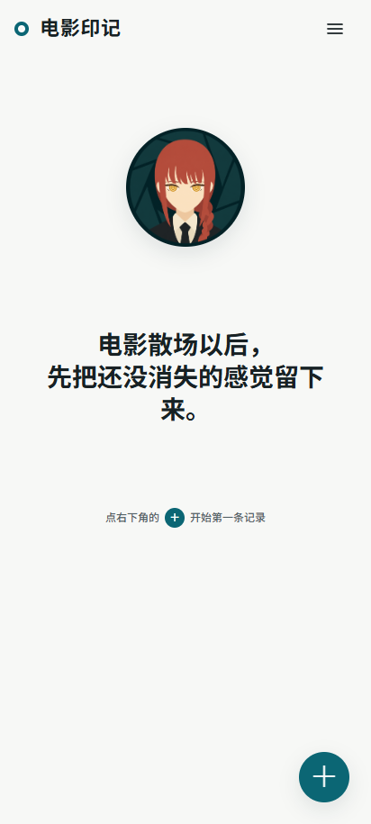
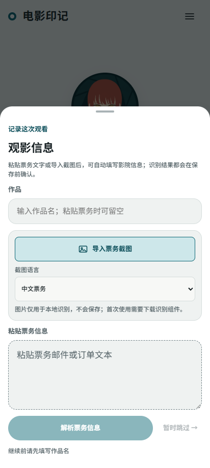

# 电影印记 · Movie Imprint

**把散场后的几句话，留成日后还能找回的观影记忆。**

电影印记是我从个人观影习惯出发设计与开发的独立产品：一个面向手机使用的电影记忆 Web App。随手记录感想、保存观影场次，再借助可选的 AI 整理，把零散的文字积累成属于自己的作品书架与观影履历。

**[打开在线应用 →](https://movie-imprint.pages.dev/)** · [产品设计](docs/PRODUCT_DEFINITION_MVP_V1.md) · [实现与演进](docs/IMPLEMENTATION_STATUS_R6.md)

> 当前为持续迭代的个人项目。无需注册即可使用浏览器本地记录；在线实例的 AI、外部检索及云端同步受部署配置与访问密码控制。云端采用个人共享密码机制，尚无多用户账户隔离，访客请使用本地模式。

## 界面预览

以下为在线版本的移动端实截图，使用无账号、无私人记录的空白会话。

<p>
  
  
</p>

## 为什么做这个产品

看完电影后，最想留下的往往是一个镜头、一句台词、影院里的体验，或当下说不清的情绪。这些内容散落在便签和聊天里，过一阵子就很难找回；同一部电影重看之后，新的感受也容易覆盖旧的记忆。

我希望记录的起点足够轻：先把真实感想写下来，之后再整理。产品围绕三个问题展开：**怎样降低记录负担，怎样让 AI 的整理可信，怎样让每次观看都能被重新找到。**

## 可以用它做什么

| 场景 | 当前能力 |
| --- | --- |
| 散场后随手记 | 填写或跳过观影信息，直接写感想；草稿自动保存，原文独立保留 |
| 留住具体瞬间 | 将感想整理成记忆卡片；AI 建议可编辑、删除，也可以手动补充 |
| 表达自己的判断 | 分别记录个人态度与推荐判断，保留“我喜欢，但未必推荐”的空间 |
| 记下这一次观看 | 手填场次、粘贴票务文字或导入截图识别，确认影院、时间和放映制式等信息 |
| 回看自己的变化 | 通过作品书架、观影履历、同一作品的多次记录和评价变迁回顾体验 |
| 规划下一部电影 | 独立创建片单，搜索并加入尚未观看、尚未写过感想的作品 |
| 找到与带走记录 | 使用标签组织内容，导出 Markdown、JSON、TXT，或生成分享卡片 |

作品资料接入 **Bangumi 与 TMDB**：前者补充日本动画相关信息，后者扩展真人电影与更广泛的电影检索。外部资料用于确认作品身份，不代替个人感受。

## 第一次使用

1. 在手机或电脑上[打开应用](https://movie-imprint.pages.dev/)，从新增记录入口开始。
2. 填写观影信息，或暂时跳过；写下刚看完时的真实感想。
3. 保存原文。若实例已配置并授权 AI，可进一步整理，逐项确认需要保留的内容。
4. 在作品页继续补充记忆、查看重看记录，或将内容导出。

支持安装到手机主屏幕的 PWA 体验。未开启云端同步时，记录保存在**当前浏览器、当前站点的 IndexedDB**；换设备不会自动带走数据，清理站点数据可能删除记录，请定期导出。AI、外部检索与云端同步需要网络。

## 产品设计中的取舍

### 先记录，再组织

观影场景与感想分步输入，信息允许跳过，后续可以补全。作品、一次观看和一段感想分别建模，因此可以先加一部想看的电影，也可以为同一作品留下多次观看与补充记录。

### 原文与 AI 建议分别保存

原始感想是记录的依据。AI 负责提出结构化建议，输出经过结构与原文证据校验，用户仍可修改或舍弃。整理失败时保留已保存的原文，之后可以重试；推荐判断由用户选择。服务端适配 Gemini、OpenAI、Claude、DeepSeek 与 Kimi，前端只展示部署中已配置的服务。

### “喜欢”和“推荐”分别表达

个人态度描述自己的体验，推荐判断考虑对象与条件。将两者分开，可以保留私人记忆里细微甚至矛盾的感受。

### 数据可以长期积累，也可以带走

本地模式降低首次使用门槛，个人部署可以启用 Cloudflare D1 云端同步；导出内容与分享、复制、下载的交付方式分开实现，适配手机浏览器能力。保存与公开分享是两个独立操作。

## 技术实现

| 层次 | 实现 |
| --- | --- |
| 前端 | 原生 JavaScript ES Modules、HTML、CSS；移动端布局、浅色／深色主题 |
| 本地与安装 | IndexedDB、Web App Manifest、Service Worker |
| 服务端 | 本地 Node.js HTTP 服务；线上 Cloudflare Pages Functions |
| 持久化 | IndexedDB 本地存储；可选 Cloudflare D1 同步与本地数据上传 |
| 外部服务 | 服务端 AI 适配层、Bangumi／TMDB 搜索及图片代理；浏览器端票务 OCR |
| 验证 | Node.js 内置测试运行器、Playwright 流程与视觉检查、可选真实 AI 质量验证 |

核心实体为 **Work（作品）、ViewingEvent（一次观看）、Record（感想记录）**。Work 使用永久内部 ID，Bangumi／TMDB 等外部标识作为引用保存，避免在匹配外部作品时更换主键、破坏已有记录与片单关联。这一设计来自实际迭代中对重复作品和关联问题的修正，详见 [R6 数据模型说明](docs/IMPLEMENTATION_STATUS_R6.md)。

```text
浏览器 UI ── 领域模块 ── IndexedDB（本地模式）
    │
    └── /api/* ── Cloudflare Pages Functions
                      ├── D1（启用个人云端同步后）
                      ├── AI 服务适配层
                      └── Bangumi / TMDB
```

## 本地运行

需要 **Node.js 20+** 与 pnpm。基础记录功能不需要配置 API 密钥。

```bash
git clone https://github.com/Qiankunyi/movie-imprint.git
cd movie-imprint
pnpm install
pnpm dev
```

打开 <http://127.0.0.1:4173>。本地 Node 服务不自动加载 `.env`；如需 AI 或 TMDB，请先在运行环境中设置变量，例如 PowerShell：

```powershell
$env:GEMINI_API_KEY="<your-api-key>"
$env:TMDB_ACCESS_TOKEN="<your-tmdb-read-access-token>"
pnpm dev
```

| 可选配置 | 用途 |
| --- | --- |
| `GEMINI_API_KEY` / `OPENAI_API_KEY` / `ANTHROPIC_API_KEY` / `DEEPSEEK_API_KEY` / `MOONSHOT_API_KEY` | 对应 AI 服务；按需配置 |
| `AI_PROVIDER`、对应的 `*_MODEL` | 默认服务与模型配置，详见 [AI 适配层](src/ai-providers.js) |
| `TMDB_ACCESS_TOKEN` 或 `TMDB_API_KEY` | TMDB 电影检索；`TMDB_LANGUAGE` 默认 `zh-CN` |
| `BANGUMI_USER_AGENT`、`BANGUMI_ACCESS_TOKEN` | Bangumi 应用标识与可选令牌；User-Agent 使用 ASCII |
| `ACCESS_PASSWORD` | Cloudflare 线上 `/api/*` 访问保护；不是多用户账户系统 |

### 部署到 Cloudflare Pages

1. Fork 仓库并创建 Pages 项目，连接自己的仓库。当前应用没有前端编译步骤，构建命令留空，输出目录为项目根目录 `.`。
2. 若使用云端同步，创建自己的 D1 数据库，将 [wrangler.toml](wrangler.toml) 中的数据库名称与 ID 替换为自己的值，保持 binding 为 `DB`。
3. 对自己的 D1 数据库执行 [初始化 SQL](functions/api/sync/_schema.sql)，例如 `wrangler d1 execute <database-name> --remote --file=functions/api/sync/_schema.sql`。
4. 在 Cloudflare 配置 `ACCESS_PASSWORD` 及所需的服务端密钥，再部署。个人云端部署务必设置访问密码：当前中间件在未设置密码时会放行 API。
5. 如需同步，在应用设置中输入自己部署的访问密码、测试连接，再按需上传本机数据。已有本地记录不会自动迁移。

Cloudflare 本地调试可使用 `wrangler pages dev . --port 4173`，密钥放入已忽略的 `.dev.vars`。`pnpm dev` 用于本地记录与代理接口开发，不包含 D1 同步后端。

### 验证命令

```bash
pnpm test                          # 领域逻辑、解析、导出、数据关联等回归测试
pnpm exec playwright install chromium
pnpm test:e2e                      # 浏览器交互与持久化流程
pnpm screenshots                   # 生成移动端关键状态截图
pnpm test:ai-live                   # 可选：真实 Gemini 质量验证，需要密钥并产生 API 调用
```

## 数据与隐私边界

- **本地模式**：记录留在当前浏览器。启用云端同步后，数据会写入该部署实例的 D1；同步失败可能回落本地，两端不保证实时一致。
- **AI 整理**：发起整理时，相关感想与整理资料会经服务端发送给所选 AI 服务商；请按自身隐私需求决定是否使用。
- **票务截图**：OCR 在浏览器端执行，识别依赖按需从 CDN 加载；识别结果需人工确认。票务敏感字段的处理见 [票务解析模块](src/ticket.js)。
- **密钥与导出**：AI 与数据源密钥配置在服务端；记录导出不包含服务端密钥或访问密码。请勿将 `.env`、`.dev.vars` 或私人记录提交到公开源码仓库。
- **实例边界**：目前服务于个人使用与自部署，尚未提供多用户账户隔离、权限分级或协作空间。

## 项目记录

我围绕个人需求推进产品定义、交互与视觉设计、数据模型、功能实现和上线迭代，并在仓库中保留设计与验证文档：

- [最初的产品定义](docs/PRODUCT_DEFINITION_MVP_V1.md)：问题、范围与记录原则。
- [交互设计修订](docs/INTERACTION_DESIGN_REVISION_V2.md)：记录负担与渐进式展开。
- [作品书架与回顾](docs/handoff/R4_WORK_SHELF.md)：围绕作品组织长期记忆。
- [片单与多数据源迭代](docs/IMPLEMENTATION_STATUS_R6.md)：观影前建卡、稳定身份与外部引用。
- [验证资料](docs/validation/VALIDATION_DATASET_V1.md)：以合成样本检查整理行为。

这些文档记录了不同阶段的设计与实现，部分早期方案已被后续迭代替代；当前功能以代码和本 README 为准。GitHub 自动存档等早期设想不作为当前已交付能力展示。

作者：[Qiankunyi](https://github.com/Qiankunyi) · 反馈：[GitHub Issues](https://github.com/Qiankunyi/movie-imprint/issues)
